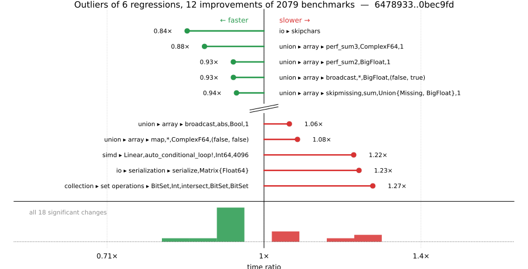

# Benchmark Report

## Summary

**2079** benchmarks were executed, **6** showed regressions, and **12** showed improvements.



## Job Properties

*Commits:* [tecosaur/julia@0bec9fd453a6463397433b82cfe8c2bebe117847](https://github.com/tecosaur/julia/commit/0bec9fd453a6463397433b82cfe8c2bebe117847) vs [JuliaLang/julia@6478933d4232a63baa7286faf5182a8521f6fb05](https://github.com/JuliaLang/julia/commit/6478933d4232a63baa7286faf5182a8521f6fb05)

*Comparison Diff:* [6478933...0bec9fd](https://github.com/JuliaLang/julia/compare/6478933d4232a63baa7286faf5182a8521f6fb05...tecosaur/julia:0bec9fd453a6463397433b82cfe8c2bebe117847)

*Triggered By:* [link](https://github.com/JuliaLang/julia/pull/65060#issuecomment-7008494477)

*Tag Predicate:* `"simd" || ("collection" || ("union" || "io"))`

## Results

*Note: If Chrome is your browser, I strongly recommend installing the [Wide GitHub](https://chrome.google.com/webstore/detail/wide-github/kaalofacklcidaampbokdplbklpeldpj?hl=en)
extension, which makes the result table easier to read.*

Below is a table of this job's results, obtained by running the benchmarks found in
[JuliaCI/BaseBenchmarks.jl](https://github.com/JuliaCI/BaseBenchmarks.jl). The values
listed in the `ID` column have the structure `[parent_group, child_group, ..., key]`,
and can be used to index into the BaseBenchmarks suite to retrieve the corresponding
benchmarks.

The percentages accompanying time and memory values in the below table are noise tolerances. The "true"
time/memory value for a given benchmark is expected to fall within this percentage of the reported value.

A ratio greater than `1.0` denotes a possible regression (marked with :x:), while a ratio less
than `1.0` denotes a possible improvement (marked with :white_check_mark:). Only significant results - results
that indicate possible regressions or improvements - are shown below (thus, an empty table means that all
benchmark results remained invariant between builds).

| ID | time ratio | memory ratio |
|----|------------|--------------|
| `["collection", "set operations", ("BitSet", "Int", "intersect", "BitSet", "BitSet")]` | 1.27 (25%) :x: | 1.00 (1%)  |
| `["io", "serialization", ("serialize", "Matrix{Float64}")]` | 1.23 (5%) :x: | 1.00 (1%)  |
| `["io", "skipchars"]` | 0.84 (5%) :white_check_mark: | 1.00 (1%)  |
| `["simd", ("Linear", "auto_conditional_loop!", "Int64", 4096)]` | 1.22 (20%) :x: | 1.00 (1%)  |
| `["union", "array", ("broadcast", "*", "BigFloat", "(false, true)")]` | 0.93 (5%) :white_check_mark: | 1.00 (1%)  |
| `["union", "array", ("broadcast", "abs", "Bool", 1)]` | 1.06 (5%) :x: | 1.00 (1%)  |
| `["union", "array", ("broadcast", "identity", "ComplexF64", 0)]` | 0.95 (5%) :white_check_mark: | 1.00 (1%)  |
| `["union", "array", ("broadcast", "identity", "Int8", 1)]` | 0.94 (5%) :white_check_mark: | 1.00 (1%)  |
| `["union", "array", ("collect", "all", "BigInt", 0)]` | 0.95 (5%) :white_check_mark: | 1.00 (1%)  |
| `["union", "array", ("map", "*", "ComplexF64", "(false, false)")]` | 1.08 (5%) :x: | 1.00 (1%)  |
| `["union", "array", ("map", "abs", "Float32", 0)]` | 0.95 (5%) :white_check_mark: | 1.00 (1%)  |
| `["union", "array", ("perf_binaryop", "*", "BigFloat", "(true, true)")]` | 0.95 (5%) :white_check_mark: | 1.00 (1%)  |
| `["union", "array", ("perf_binaryop", "*", "Float64", "(true, true)")]` | 1.05 (5%) :x: | 1.00 (1%)  |
| `["union", "array", ("perf_sum", "BigFloat", 1)]` | 0.95 (5%) :white_check_mark: | 1.00 (1%)  |
| `["union", "array", ("perf_sum2", "BigFloat", 1)]` | 0.93 (5%) :white_check_mark: | 1.00 (1%)  |
| `["union", "array", ("perf_sum3", "ComplexF64", 1)]` | 0.88 (5%) :white_check_mark: | 1.00 (1%)  |
| `["union", "array", ("skipmissing", "perf_sumskipmissing", "Union{Missing, BigFloat}", 1)]` | 0.94 (5%) :white_check_mark: | 1.00 (1%)  |
| `["union", "array", ("skipmissing", "sum", "Union{Missing, BigFloat}", 1)]` | 0.94 (5%) :white_check_mark: | 1.00 (1%)  |

## Benchmark Group List

Here's a list of all the benchmark groups executed by this job:

- `["array", "index"]`
- `["collection", "deletion"]`
- `["collection", "initialization"]`
- `["collection", "iteration"]`
- `["collection", "optimizations"]`
- `["collection", "queries & updates"]`
- `["collection", "set operations"]`
- `["io", "array_limit"]`
- `["io", "read"]`
- `["io", "serialization"]`
- `["io"]`
- `["problem", "seismic"]`
- `["simd"]`
- `["union", "array"]`

## Version Info

#### Primary Build

```
Julia Version 1.15.0-DEV.844
Build Info:
  Commit 0bec9fd453 (2026-11-19 11:23 UTC)
  GC: Built with stock GC
  Base Sysimage: native (x86_64-linux-gnu)
  Matched Sysimage: native
Platform Info:
  OS: Linux (x86_64-unknown-linux-gnu)
      Ubuntu 22.04.5 LTS
  uname: Linux 5.15.0-203-generic #213-Ubuntu SMP Fri Oct 23 13:21:06 UTC 2026 x86_64 x86_64
  CPU: Intel(R) Xeon(R) CPU E3-1241 v3 @ 3.50GHz (haswell):
              speed         user         nice          sys         idle          irq
       #1  3500 MHz       1436 s          1 s        185 s     143967 s          0 s  
       #2  3500 MHz      31091 s          0 s        635 s     114054 s          0 s  
       #3  3501 MHz       1494 s          0 s         88 s     144184 s          0 s  
       #4  3499 MHz       1249 s          0 s         82 s     144458 s          0 s  
       #5  3503 MHz       1391 s          0 s         79 s     144198 s          0 s  
       #6  3501 MHz       1377 s          0 s         78 s     143689 s          0 s  
       #7  3501 MHz       1513 s          0 s         83 s     144113 s          0 s  
       #8  3500 MHz       1296 s          1 s         82 s     144394 s          0 s  
  Memory: 31.301 GiB (23.293 GiB free)
  Uptime: 145895.38 sec
  Load Avg:  1.03  1.04  1.04
  WORD_SIZE: 64
  LLVM: libLLVM-23.1.4 (ORCJIT, haswell)
Threads: 1 default, 1 interactive, 1 GC (on 8 virtual cores)

```

#### Comparison Build

```
Julia Version 1.15.0-DEV.839
Build Info:
  Commit 6478933d42 (2026-11-19 05:58 UTC)
  GC: Built with stock GC
  Base Sysimage: native (x86_64-linux-gnu)
  Matched Sysimage: native
Platform Info:
  OS: Linux (x86_64-unknown-linux-gnu)
      Ubuntu 22.04.5 LTS
  uname: Linux 5.15.0-203-generic #213-Ubuntu SMP Fri Oct 23 13:21:06 UTC 2026 x86_64 x86_64
  CPU: Intel(R) Xeon(R) CPU E3-1241 v3 @ 3.50GHz (haswell):
              speed         user         nice          sys         idle          irq
       #1  3500 MHz       1477 s          1 s        202 s     148204 s          0 s  
       #2  3500 MHz      35314 s          0 s        670 s     114183 s          0 s  
       #3  3500 MHz       1520 s          0 s         89 s     148541 s          0 s  
       #4  3500 MHz       1256 s          0 s         84 s     148828 s          0 s  
       #5  3500 MHz       1399 s          0 s         80 s     148573 s          0 s  
       #6  3502 MHz       1384 s          0 s         79 s     148060 s          0 s  
       #7  3502 MHz       1536 s          0 s         85 s     148475 s          0 s  
       #8  3501 MHz       1311 s          1 s         83 s     148764 s          0 s  
  Memory: 31.301 GiB (23.286 GiB free)
  Uptime: 150282.72 sec
  Load Avg:  1.0  1.0  1.0
  WORD_SIZE: 64
  LLVM: libLLVM-23.1.4 (ORCJIT, haswell)
Threads: 1 default, 1 interactive, 1 GC (on 8 virtual cores)

```

#### Nanosoldier
Nanosoldier commit: [`a31ca97`](https://github.com/JuliaCI/Nanosoldier.jl/commit/a31ca97d24f0e880a5d3b4ba999344a5fffb696f)
