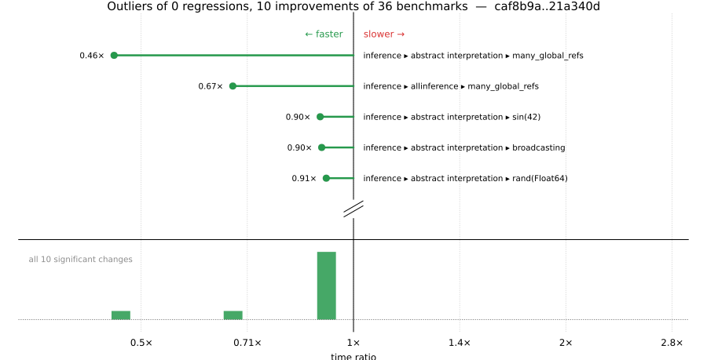

# Benchmark Report

## Summary

**36** benchmarks were executed, **0** showed regressions, and **10** showed improvements.



## Job Properties

*Commits:* [JuliaLang/julia@21a340d811d99025789b94a7f9603f88dd9d4bc2](https://github.com/JuliaLang/julia/commit/21a340d811d99025789b94a7f9603f88dd9d4bc2) vs [JuliaLang/julia@caf8b9a1a8bdb9667af1af63793659122c093936](https://github.com/JuliaLang/julia/commit/caf8b9a1a8bdb9667af1af63793659122c093936)

*Comparison Diff:* [caf8b9a...21a340d](https://github.com/JuliaLang/julia/compare/caf8b9a1a8bdb9667af1af63793659122c093936...21a340d811d99025789b94a7f9603f88dd9d4bc2)

*Note:* Comparison is against the merge-base of `master` (the common ancestor of the PR branch and `master`), so it reflects only the PR's changes.

*Triggered By:* [link](https://github.com/JuliaLang/julia/pull/65113#issuecomment-7040103344)

*Tag Predicate:* `"inference"`

## Results

*Note: If Chrome is your browser, I strongly recommend installing the [Wide GitHub](https://chrome.google.com/webstore/detail/wide-github/kaalofacklcidaampbokdplbklpeldpj?hl=en)
extension, which makes the result table easier to read.*

Below is a table of this job's results, obtained by running the benchmarks found in
[JuliaCI/BaseBenchmarks.jl](https://github.com/JuliaCI/BaseBenchmarks.jl). The values
listed in the `ID` column have the structure `[parent_group, child_group, ..., key]`,
and can be used to index into the BaseBenchmarks suite to retrieve the corresponding
benchmarks.

The percentages accompanying time and memory values in the below table are noise tolerances. The "true"
time/memory value for a given benchmark is expected to fall within this percentage of the reported value.

A ratio greater than `1.0` denotes a possible regression (marked with :x:), while a ratio less
than `1.0` denotes a possible improvement (marked with :white_check_mark:). Only significant results - results
that indicate possible regressions or improvements - are shown below (thus, an empty table means that all
benchmark results remained invariant between builds).

| ID | time ratio | memory ratio |
|----|------------|--------------|
| `["inference", "abstract interpretation", "Base.init_stdio(::Ptr{Cvoid})"]` | 0.93 (5%) :white_check_mark: | 1.00 (1%)  |
| `["inference", "abstract interpretation", "REPL.REPLCompletions.completions"]` | 0.93 (5%) :white_check_mark: | 1.00 (1%)  |
| `["inference", "abstract interpretation", "broadcasting"]` | 0.90 (5%) :white_check_mark: | 1.00 (1%)  |
| `["inference", "abstract interpretation", "many_global_refs"]` | 0.46 (5%) :white_check_mark: | 0.66 (1%) :white_check_mark: |
| `["inference", "abstract interpretation", "many_invoke_calls"]` | 0.92 (5%) :white_check_mark: | 1.00 (1%)  |
| `["inference", "abstract interpretation", "println(::QuoteNode)"]` | 0.92 (5%) :white_check_mark: | 1.00 (1%)  |
| `["inference", "abstract interpretation", "rand(Float64)"]` | 0.91 (5%) :white_check_mark: | 1.00 (1%)  |
| `["inference", "abstract interpretation", "sin(42)"]` | 0.90 (5%) :white_check_mark: | 1.00 (1%)  |
| `["inference", "allinference", "many_global_refs"]` | 0.67 (5%) :white_check_mark: | 0.86 (1%) :white_check_mark: |
| `["inference", "allinference", "sin(42)"]` | 0.94 (5%) :white_check_mark: | 1.00 (1%)  |

## Benchmark Group List

Here's a list of all the benchmark groups executed by this job:

- `["inference", "abstract interpretation"]`
- `["inference", "allinference"]`
- `["inference", "optimization"]`

## Version Info

#### Primary Build

```
Julia Version 1.15.0-DEV.863
Build Info:
  Commit 21a340d811 (2026-11-20 12:47 UTC)
  GC: Built with stock GC
  Base Sysimage: native (x86_64-linux-gnu)
  Matched Sysimage: native
Platform Info:
  OS: Linux (x86_64-unknown-linux-gnu)
      Ubuntu 22.04.5 LTS
  uname: Linux 5.15.0-203-generic #213-Ubuntu SMP Fri Oct 23 13:21:06 UTC 2026 x86_64 x86_64
  CPU: Intel(R) Xeon(R) CPU E3-1241 v3 @ 3.50GHz (haswell):
              speed         user         nice          sys         idle          irq
       #1  3500 MHz       2878 s          1 s        298 s     229343 s          0 s  
       #2  3501 MHz      41047 s          0 s        741 s     191122 s          0 s  
       #3  3500 MHz       2820 s          0 s        158 s     229907 s          0 s  
       #4  3500 MHz       2487 s          0 s        150 s     230279 s          0 s  
       #5  3503 MHz       2758 s          0 s        144 s     229829 s          0 s  
       #6  3501 MHz       2807 s          2 s        142 s     228913 s          0 s  
       #7  3500 MHz       2838 s          0 s        154 s     229790 s          0 s  
       #8  3503 MHz       2662 s          1 s        148 s     230071 s          0 s  
  Memory: 31.301 GiB (22.861 GiB free)
  Uptime: 233098.12 sec
  Load Avg:  1.0  1.01  1.42
  WORD_SIZE: 64
  LLVM: libLLVM-23.1.4 (ORCJIT, haswell)
Threads: 1 default, 1 interactive, 1 GC (on 8 virtual cores)

```

#### Comparison Build

```
Julia Version 1.15.0-DEV.861
Build Info:
  Commit caf8b9a1a8 (2026-11-20 04:58 UTC)
  GC: Built with stock GC
  Base Sysimage: native (x86_64-linux-gnu)
  Matched Sysimage: native
Platform Info:
  OS: Linux (x86_64-unknown-linux-gnu)
      Ubuntu 22.04.5 LTS
  uname: Linux 5.15.0-203-generic #213-Ubuntu SMP Fri Oct 23 13:21:06 UTC 2026 x86_64 x86_64
  CPU: Intel(R) Xeon(R) CPU E3-1241 v3 @ 3.50GHz (haswell):
              speed         user         nice          sys         idle          irq
       #1  3500 MHz       2899 s          1 s        305 s     230751 s          0 s  
       #2  3500 MHz      42438 s          0 s        743 s     191203 s          0 s  
       #3  3499 MHz       2845 s          0 s        159 s     231354 s          0 s  
       #4  3500 MHz       2507 s          0 s        151 s     231732 s          0 s  
       #5  3503 MHz       2764 s          0 s        145 s     231294 s          0 s  
       #6  3313 MHz       2814 s          2 s        142 s     230378 s          0 s  
       #7  3501 MHz       2851 s          0 s        155 s     231251 s          0 s  
       #8  3499 MHz       2670 s          1 s        148 s     231537 s          0 s  
  Memory: 31.301 GiB (23.450 GiB free)
  Uptime: 234572.9 sec
  Load Avg:  1.01  1.01  1.08
  WORD_SIZE: 64
  LLVM: libLLVM-23.1.4 (ORCJIT, haswell)
Threads: 1 default, 1 interactive, 1 GC (on 8 virtual cores)

```

#### Nanosoldier
Nanosoldier commit: [`a31ca97`](https://github.com/JuliaCI/Nanosoldier.jl/commit/a31ca97d24f0e880a5d3b4ba999344a5fffb696f)
