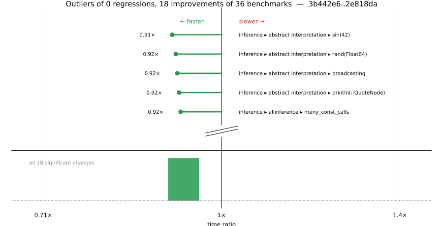

# Benchmark Report

## Summary

**36** benchmarks were executed, **0** showed regressions, and **18** showed improvements.



## Job Properties

*Commits:* [JuliaLang/julia@2e818dab52d3fcf0d89b3f6c7c3a424afab6961e](https://github.com/JuliaLang/julia/commit/2e818dab52d3fcf0d89b3f6c7c3a424afab6961e) vs [JuliaLang/julia@3b442e658f16b752449b0b2dcb29dd35b10fa1d0](https://github.com/JuliaLang/julia/commit/3b442e658f16b752449b0b2dcb29dd35b10fa1d0)

*Comparison Diff:* [3b442e6...2e818da](https://github.com/JuliaLang/julia/compare/3b442e658f16b752449b0b2dcb29dd35b10fa1d0...2e818dab52d3fcf0d89b3f6c7c3a424afab6961e)

*Triggered By:* [link](https://github.com/JuliaLang/julia/pull/64244#issuecomment-6413249386)

*Tag Predicate:* `"inference"`

## Results

*Note: If Chrome is your browser, I strongly recommend installing the [Wide GitHub](https://chrome.google.com/webstore/detail/wide-github/kaalofacklcidaampbokdplbklpeldpj?hl=en)
extension, which makes the result table easier to read.*

Below is a table of this job's results, obtained by running the benchmarks found in
[JuliaCI/BaseBenchmarks.jl](https://github.com/JuliaCI/BaseBenchmarks.jl). The values
listed in the `ID` column have the structure `[parent_group, child_group, ..., key]`,
and can be used to index into the BaseBenchmarks suite to retrieve the corresponding
benchmarks.

The percentages accompanying time and memory values in the below table are noise tolerances. The "true"
time/memory value for a given benchmark is expected to fall within this percentage of the reported value.

A ratio greater than `1.0` denotes a possible regression (marked with :x:), while a ratio less
than `1.0` denotes a possible improvement (marked with :white_check_mark:). Only significant results - results
that indicate possible regressions or improvements - are shown below (thus, an empty table means that all
benchmark results remained invariant between builds).

| ID | time ratio | memory ratio |
|----|------------|--------------|
| `["inference", "abstract interpretation", "Base.init_stdio(::Ptr{Cvoid})"]` | 0.93 (5%) :white_check_mark: | 1.00 (1%)  |
| `["inference", "abstract interpretation", "REPL.REPLCompletions.completions"]` | 0.93 (5%) :white_check_mark: | 0.99 (1%)  |
| `["inference", "abstract interpretation", "broadcasting"]` | 0.92 (5%) :white_check_mark: | 0.99 (1%)  |
| `["inference", "abstract interpretation", "many_invoke_calls"]` | 0.94 (5%) :white_check_mark: | 1.00 (1%)  |
| `["inference", "abstract interpretation", "println(::QuoteNode)"]` | 0.92 (5%) :white_check_mark: | 1.00 (1%)  |
| `["inference", "abstract interpretation", "rand(Float64)"]` | 0.92 (5%) :white_check_mark: | 1.00 (1%)  |
| `["inference", "abstract interpretation", "sin(42)"]` | 0.91 (5%) :white_check_mark: | 1.00 (1%)  |
| `["inference", "allinference", "Base.init_stdio(::Ptr{Cvoid})"]` | 0.94 (5%) :white_check_mark: | 1.00 (1%)  |
| `["inference", "allinference", "REPL.REPLCompletions.completions"]` | 0.94 (5%) :white_check_mark: | 1.00 (1%)  |
| `["inference", "allinference", "broadcasting"]` | 0.94 (5%) :white_check_mark: | 1.00 (1%)  |
| `["inference", "allinference", "many_const_calls"]` | 0.92 (5%) :white_check_mark: | 1.00 (1%)  |
| `["inference", "allinference", "many_invoke_calls"]` | 0.94 (5%) :white_check_mark: | 1.00 (1%)  |
| `["inference", "allinference", "println(::QuoteNode)"]` | 0.94 (5%) :white_check_mark: | 1.00 (1%)  |
| `["inference", "allinference", "rand(Float64)"]` | 0.93 (5%) :white_check_mark: | 1.00 (1%)  |
| `["inference", "allinference", "sin(42)"]` | 0.93 (5%) :white_check_mark: | 1.00 (1%)  |
| `["inference", "optimization", "many_global_refs"]` | 0.93 (5%) :white_check_mark: | 1.00 (1%)  |
| `["inference", "optimization", "many_invoke_calls"]` | 0.93 (5%) :white_check_mark: | 1.00 (1%)  |
| `["inference", "optimization", "rand(Float64)"]` | 0.94 (5%) :white_check_mark: | 1.00 (1%)  |

## Benchmark Group List

Here's a list of all the benchmark groups executed by this job:

- `["inference", "abstract interpretation"]`
- `["inference", "allinference"]`
- `["inference", "optimization"]`

## Version Info

#### Primary Build

```
Julia Version 1.15.0-DEV.141
Build Info:
  Commit 2e818dab52 (2026-10-26 09:54 UTC)
  GC: Built with stock GC
  Base Sysimage: native (x86_64-linux-gnu)
  Matched Sysimage: native
Platform Info:
  OS: Linux (x86_64-unknown-linux-gnu)
      Ubuntu 22.04.5 LTS
  uname: Linux 5.15.0-174-generic #184-Ubuntu SMP Fri Mar 13 18:41:50 UTC 2026 x86_64 x86_64
  CPU: Intel(R) Xeon(R) CPU E3-1241 v3 @ 3.50GHz (haswell):
              speed         user         nice          sys         idle          irq
       #1  3500 MHz     159651 s        107 s      49559 s   17586981 s          0 s  
       #2  3500 MHz    1610092 s         74 s      62093 s   16140320 s          0 s  
       #3  3500 MHz     132271 s         69 s      27809 s   17597449 s          0 s  
       #4  3501 MHz     137487 s         48 s      31096 s   17644794 s          0 s  
  Memory: 31.301 GiB (22.603 GiB free)
  Uptime: 1.783798737e7 sec
  Load Avg:  1.0  1.02  1.59
  WORD_SIZE: 64
  LLVM: libLLVM-23.1.4 (ORCJIT, haswell)
Threads: 1 default, 1 interactive, 1 GC (on 4 virtual cores)

```

#### Comparison Build

```
Julia Version 1.15.0-DEV.140
Build Info:
  Commit 3b442e658f (2026-10-26 09:16 UTC)
  GC: Built with stock GC
  Base Sysimage: native (x86_64-linux-gnu)
  Matched Sysimage: native
Platform Info:
  OS: Linux (x86_64-unknown-linux-gnu)
      Ubuntu 22.04.5 LTS
  uname: Linux 5.15.0-174-generic #184-Ubuntu SMP Fri Mar 13 18:41:50 UTC 2026 x86_64 x86_64
  CPU: Intel(R) Xeon(R) CPU E3-1241 v3 @ 3.50GHz (haswell):
              speed         user         nice          sys         idle          irq
       #1  3500 MHz     159686 s        107 s      49576 s   17588417 s          0 s  
       #2  3500 MHz    1611518 s         74 s      62095 s   16140387 s          0 s  
       #3  3500 MHz     132317 s         69 s      27816 s   17598887 s          0 s  
       #4  3500 MHz     137503 s         48 s      31098 s   17646271 s          0 s  
  Memory: 31.301 GiB (22.602 GiB free)
  Uptime: 1.783948263e7 sec
  Load Avg:  1.0  1.0  1.1
  WORD_SIZE: 64
  LLVM: libLLVM-23.1.4 (ORCJIT, haswell)
Threads: 1 default, 1 interactive, 1 GC (on 4 virtual cores)

```

#### Nanosoldier
Nanosoldier commit: [`337e360`](https://github.com/JuliaCI/Nanosoldier.jl/commit/337e360a4a5ca6d9e9b96245ce90e4f3a3be95c6)
