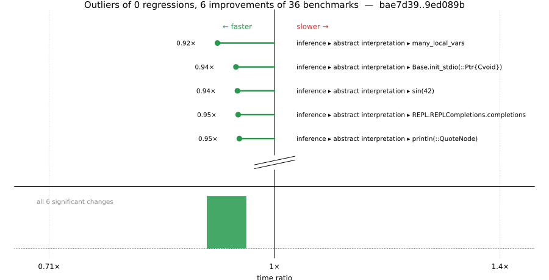

# Benchmark Report

## Summary

**36** benchmarks were executed, **0** showed regressions, and **6** showed improvements.



## Job Properties

*Commits:* [JuliaLang/julia@9ed089b511dbc20233e7e787d5584e2e30ea46c4](https://github.com/JuliaLang/julia/commit/9ed089b511dbc20233e7e787d5584e2e30ea46c4) vs [JuliaLang/julia@bae7d3922a57809df757809cc0ce5dc45e6da36e](https://github.com/JuliaLang/julia/commit/bae7d3922a57809df757809cc0ce5dc45e6da36e)

*Comparison Diff:* [bae7d39...9ed089b](https://github.com/JuliaLang/julia/compare/bae7d3922a57809df757809cc0ce5dc45e6da36e...9ed089b511dbc20233e7e787d5584e2e30ea46c4)

*Note:* Comparison is against the merge-base of `master` (the common ancestor of the PR branch and `master`), so it reflects only the PR's changes.

*Triggered By:* [link](https://github.com/JuliaLang/julia/pull/65250#issuecomment-7176782068)

*Tag Predicate:* `"inference"`

## Results

*Note: If Chrome is your browser, I strongly recommend installing the [Wide GitHub](https://chrome.google.com/webstore/detail/wide-github/kaalofacklcidaampbokdplbklpeldpj?hl=en)
extension, which makes the result table easier to read.*

Below is a table of this job's results, obtained by running the benchmarks found in
[JuliaCI/BaseBenchmarks.jl](https://github.com/JuliaCI/BaseBenchmarks.jl). The values
listed in the `ID` column have the structure `[parent_group, child_group, ..., key]`,
and can be used to index into the BaseBenchmarks suite to retrieve the corresponding
benchmarks.

The percentages accompanying time and memory values in the below table are noise tolerances. The "true"
time/memory value for a given benchmark is expected to fall within this percentage of the reported value.

A ratio greater than `1.0` denotes a possible regression (marked with :x:), while a ratio less
than `1.0` denotes a possible improvement (marked with :white_check_mark:). Only significant results - results
that indicate possible regressions or improvements - are shown below (thus, an empty table means that all
benchmark results remained invariant between builds).

| ID | time ratio | memory ratio |
|----|------------|--------------|
| `["inference", "abstract interpretation", "Base.init_stdio(::Ptr{Cvoid})"]` | 0.94 (5%) :white_check_mark: | 1.00 (1%)  |
| `["inference", "abstract interpretation", "REPL.REPLCompletions.completions"]` | 0.95 (5%) :white_check_mark: | 1.00 (1%)  |
| `["inference", "abstract interpretation", "many_local_vars"]` | 0.92 (5%) :white_check_mark: | 1.00 (1%)  |
| `["inference", "abstract interpretation", "println(::QuoteNode)"]` | 0.95 (5%) :white_check_mark: | 1.00 (1%)  |
| `["inference", "abstract interpretation", "rand(Float64)"]` | 0.95 (5%) :white_check_mark: | 1.00 (1%)  |
| `["inference", "abstract interpretation", "sin(42)"]` | 0.94 (5%) :white_check_mark: | 1.00 (1%)  |

## Benchmark Group List

Here's a list of all the benchmark groups executed by this job:

- `["inference", "abstract interpretation"]`
- `["inference", "allinference"]`
- `["inference", "optimization"]`

## Version Info

#### Primary Build

```
Julia Version 1.15.0-DEV.997
Build Info:
  Commit 9ed089b511 (2026-11-25 13:52 UTC)
  GC: Built with stock GC
  Base Sysimage: native (x86_64-linux-gnu)
  Matched Sysimage: native
Platform Info:
  OS: Linux (x86_64-unknown-linux-gnu)
      Ubuntu 22.04.5 LTS
  uname: Linux 5.15.0-203-generic #213-Ubuntu SMP Fri Oct 23 13:21:06 UTC 2026 x86_64 x86_64
  CPU: Intel(R) Xeon(R) CPU E3-1241 v3 @ 3.50GHz (haswell):
              speed         user         nice          sys         idle          irq
       #1  3500 MHz       4880 s          4 s        598 s     693336 s          0 s  
       #2  3500 MHz      74192 s          1 s       1477 s     623886 s          0 s  
       #3  3501 MHz       5158 s          1 s        367 s     693968 s          0 s  
       #4  3501 MHz       4679 s          0 s        363 s     694534 s          0 s  
       #5  3502 MHz       4755 s          2 s        346 s     693914 s          0 s  
       #6  3501 MHz       4759 s          2 s        342 s     691149 s          0 s  
       #7  3500 MHz       5075 s          0 s        356 s     693745 s          0 s  
       #8  3503 MHz       4949 s          1 s        351 s     694157 s          0 s  
  Memory: 31.301 GiB (23.186 GiB free)
  Uptime: 700127.58 sec
  Load Avg:  1.0  1.04  1.86
  WORD_SIZE: 64
  LLVM: libLLVM-23.1.4 (ORCJIT, haswell)
Threads: 1 default, 1 interactive, 1 GC (on 8 virtual cores)

```

#### Comparison Build

```
Julia Version 1.15.0-DEV.996
Build Info:
  Commit bae7d3922a (2026-11-25 06:28 UTC)
  GC: Built with stock GC
  Base Sysimage: native (x86_64-linux-gnu)
  Matched Sysimage: native
Platform Info:
  OS: Linux (x86_64-unknown-linux-gnu)
      Ubuntu 22.04.5 LTS
  uname: Linux 5.15.0-203-generic #213-Ubuntu SMP Fri Oct 23 13:21:06 UTC 2026 x86_64 x86_64
  CPU: Intel(R) Xeon(R) CPU E3-1241 v3 @ 3.50GHz (haswell):
              speed         user         nice          sys         idle          irq
       #1  3500 MHz       4890 s          4 s        603 s     694731 s          0 s  
       #2  3500 MHz      75569 s          1 s       1479 s     623953 s          0 s  
       #3  3500 MHz       5169 s          1 s        368 s     695403 s          0 s  
       #4  3500 MHz       4698 s          0 s        365 s     695961 s          0 s  
       #5  3502 MHz       4766 s          2 s        346 s     695347 s          0 s  
       #6  3501 MHz       4769 s          2 s        343 s     692583 s          0 s  
       #7  3501 MHz       5085 s          0 s        357 s     695180 s          0 s  
       #8  3500 MHz       4957 s          1 s        352 s     695596 s          0 s  
  Memory: 31.301 GiB (23.479 GiB free)
  Uptime: 701575.31 sec
  Load Avg:  1.0  1.0  1.16
  WORD_SIZE: 64
  LLVM: libLLVM-23.1.4 (ORCJIT, haswell)
Threads: 1 default, 1 interactive, 1 GC (on 8 virtual cores)

```

#### Nanosoldier
Nanosoldier commit: [`a31ca97`](https://github.com/JuliaCI/Nanosoldier.jl/commit/a31ca97d24f0e880a5d3b4ba999344a5fffb696f)
