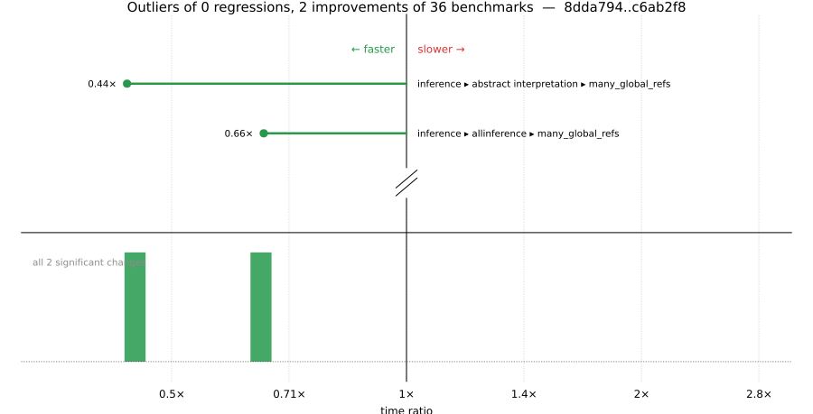

# Benchmark Report

## Summary

**36** benchmarks were executed, **0** showed regressions, and **2** showed improvements.



## Job Properties

*Commits:* [JuliaLang/julia@c6ab2f8a4cfe51f0342301e933a083ef700d05df](https://github.com/JuliaLang/julia/commit/c6ab2f8a4cfe51f0342301e933a083ef700d05df) vs [JuliaLang/julia@8dda794eec3571f4776fac724629459301e3ecfd](https://github.com/JuliaLang/julia/commit/8dda794eec3571f4776fac724629459301e3ecfd)

*Comparison Diff:* [8dda794...c6ab2f8](https://github.com/JuliaLang/julia/compare/8dda794eec3571f4776fac724629459301e3ecfd...c6ab2f8a4cfe51f0342301e933a083ef700d05df)

*Triggered By:* [link](https://github.com/JuliaLang/julia/pull/65126#issuecomment-7048615205)

*Tag Predicate:* `"inference"`

## Results

*Note: If Chrome is your browser, I strongly recommend installing the [Wide GitHub](https://chrome.google.com/webstore/detail/wide-github/kaalofacklcidaampbokdplbklpeldpj?hl=en)
extension, which makes the result table easier to read.*

Below is a table of this job's results, obtained by running the benchmarks found in
[JuliaCI/BaseBenchmarks.jl](https://github.com/JuliaCI/BaseBenchmarks.jl). The values
listed in the `ID` column have the structure `[parent_group, child_group, ..., key]`,
and can be used to index into the BaseBenchmarks suite to retrieve the corresponding
benchmarks.

The percentages accompanying time and memory values in the below table are noise tolerances. The "true"
time/memory value for a given benchmark is expected to fall within this percentage of the reported value.

A ratio greater than `1.0` denotes a possible regression (marked with :x:), while a ratio less
than `1.0` denotes a possible improvement (marked with :white_check_mark:). Only significant results - results
that indicate possible regressions or improvements - are shown below (thus, an empty table means that all
benchmark results remained invariant between builds).

| ID | time ratio | memory ratio |
|----|------------|--------------|
| `["inference", "abstract interpretation", "many_global_refs"]` | 0.44 (5%) :white_check_mark: | 0.66 (1%) :white_check_mark: |
| `["inference", "allinference", "many_global_refs"]` | 0.66 (5%) :white_check_mark: | 0.86 (1%) :white_check_mark: |

## Benchmark Group List

Here's a list of all the benchmark groups executed by this job:

- `["inference", "abstract interpretation"]`
- `["inference", "allinference"]`
- `["inference", "optimization"]`

## Version Info

#### Primary Build

```
Julia Version 1.15.0-DEV.879
Build Info:
  Commit c6ab2f8a4c (2026-11-20 19:24 UTC)
  GC: Built with stock GC
  Base Sysimage: native (x86_64-linux-gnu)
  Matched Sysimage: native
Platform Info:
  OS: Linux (x86_64-unknown-linux-gnu)
      Ubuntu 22.04.5 LTS
  uname: Linux 5.15.0-203-generic #213-Ubuntu SMP Fri Oct 23 13:21:06 UTC 2026 x86_64 x86_64
  CPU: Intel(R) Xeon(R) CPU E3-1241 v3 @ 3.50GHz (haswell):
              speed         user         nice          sys         idle          irq
       #1  3499 MHz       4506 s          5 s        467 s     249424 s          0 s  
       #2  3499 MHz      83864 s          0 s       1657 s     169525 s          0 s  
       #3  3499 MHz       3567 s          0 s        170 s     251256 s          0 s  
       #4  3500 MHz       3873 s          0 s        170 s     250992 s          0 s  
       #5  3502 MHz       3133 s          0 s        156 s     251547 s          0 s  
       #6  3501 MHz       3191 s          0 s        160 s     250639 s          0 s  
       #7  3498 MHz       3623 s          0 s        161 s     251152 s          0 s  
       #8  3502 MHz       3697 s          0 s        163 s     251135 s          0 s  
  Memory: 31.301 GiB (20.418 GiB free)
  Uptime: 255211.42 sec
  Load Avg:  1.01  1.08  1.92
  WORD_SIZE: 64
  LLVM: libLLVM-23.1.4 (ORCJIT, haswell)
Threads: 1 default, 1 interactive, 1 GC (on 8 virtual cores)

```

#### Comparison Build

```
Julia Version 1.15.0-DEV.878
Build Info:
  Commit 8dda794eec (2026-11-20 18:55 UTC)
  GC: Built with stock GC
  Base Sysimage: native (x86_64-linux-gnu)
  Matched Sysimage: native
Platform Info:
  OS: Linux (x86_64-unknown-linux-gnu)
      Ubuntu 22.04.5 LTS
  uname: Linux 5.15.0-203-generic #213-Ubuntu SMP Fri Oct 23 13:21:06 UTC 2026 x86_64 x86_64
  CPU: Intel(R) Xeon(R) CPU E3-1241 v3 @ 3.50GHz (haswell):
              speed         user         nice          sys         idle          irq
       #1  3499 MHz       4523 s          5 s        471 s     250813 s          0 s  
       #2  3499 MHz      85230 s          0 s       1659 s     169603 s          0 s  
       #3  3500 MHz       3579 s          0 s        171 s     252689 s          0 s  
       #4  3499 MHz       3885 s          0 s        171 s     252425 s          0 s  
       #5  3503 MHz       3140 s          0 s        156 s     252985 s          0 s  
       #6  3500 MHz       3198 s          0 s        161 s     252076 s          0 s  
       #7  3500 MHz       3652 s          0 s        162 s     252569 s          0 s  
       #8  3502 MHz       3704 s          0 s        163 s     252574 s          0 s  
  Memory: 31.301 GiB (21.335 GiB free)
  Uptime: 256658.56 sec
  Load Avg:  1.01  1.01  1.18
  WORD_SIZE: 64
  LLVM: libLLVM-23.1.4 (ORCJIT, haswell)
Threads: 1 default, 1 interactive, 1 GC (on 8 virtual cores)

```

#### Nanosoldier
Nanosoldier commit: [`a31ca97`](https://github.com/JuliaCI/Nanosoldier.jl/commit/a31ca97d24f0e880a5d3b4ba999344a5fffb696f)
