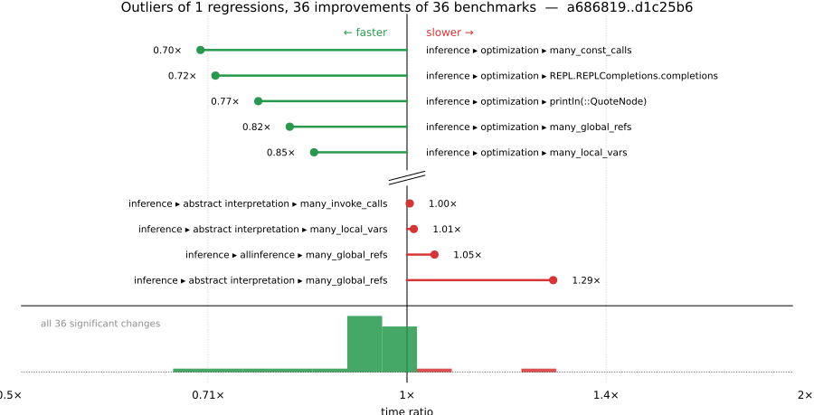

# Benchmark Report

## Summary

**36** benchmarks were executed, **1** showed regressions, and **36** showed improvements.



## Job Properties

*Commits:* [JuliaLang/julia@d1c25b66c188a81d3ca537b2787b04884589bb38](https://github.com/JuliaLang/julia/commit/d1c25b66c188a81d3ca537b2787b04884589bb38) vs [JuliaLang/julia@a6868197b6baae0a2fd9d1af2be9540e80aca061](https://github.com/JuliaLang/julia/commit/a6868197b6baae0a2fd9d1af2be9540e80aca061)

*Comparison Diff:* [a686819...d1c25b6](https://github.com/JuliaLang/julia/compare/a6868197b6baae0a2fd9d1af2be9540e80aca061...d1c25b66c188a81d3ca537b2787b04884589bb38)

*Note:* Comparison is against the merge-base of `master` (the common ancestor of the PR branch and `master`), so it reflects only the PR's changes.

*Triggered By:* [link](https://github.com/JuliaLang/julia/pull/65082#issuecomment-7021935166)

*Tag Predicate:* `"inference"`

## Results

*Note: If Chrome is your browser, I strongly recommend installing the [Wide GitHub](https://chrome.google.com/webstore/detail/wide-github/kaalofacklcidaampbokdplbklpeldpj?hl=en)
extension, which makes the result table easier to read.*

Below is a table of this job's results, obtained by running the benchmarks found in
[JuliaCI/BaseBenchmarks.jl](https://github.com/JuliaCI/BaseBenchmarks.jl). The values
listed in the `ID` column have the structure `[parent_group, child_group, ..., key]`,
and can be used to index into the BaseBenchmarks suite to retrieve the corresponding
benchmarks.

The percentages accompanying time and memory values in the below table are noise tolerances. The "true"
time/memory value for a given benchmark is expected to fall within this percentage of the reported value.

A ratio greater than `1.0` denotes a possible regression (marked with :x:), while a ratio less
than `1.0` denotes a possible improvement (marked with :white_check_mark:). Only significant results - results
that indicate possible regressions or improvements - are shown below (thus, an empty table means that all
benchmark results remained invariant between builds).

| ID | time ratio | memory ratio |
|----|------------|--------------|
| `["inference", "abstract interpretation", "Base.init_stdio(::Ptr{Cvoid})"]` | 0.99 (5%)  | 0.92 (1%) :white_check_mark: |
| `["inference", "abstract interpretation", "REPL.REPLCompletions.completions"]` | 0.99 (5%)  | 0.92 (1%) :white_check_mark: |
| `["inference", "abstract interpretation", "broadcasting"]` | 1.00 (5%)  | 0.93 (1%) :white_check_mark: |
| `["inference", "abstract interpretation", "many_const_calls"]` | 0.96 (5%)  | 0.91 (1%) :white_check_mark: |
| `["inference", "abstract interpretation", "many_global_refs"]` | 1.29 (5%) :x: | 0.92 (1%) :white_check_mark: |
| `["inference", "abstract interpretation", "many_invoke_calls"]` | 1.00 (5%)  | 0.93 (1%) :white_check_mark: |
| `["inference", "abstract interpretation", "many_local_vars"]` | 1.01 (5%)  | 0.87 (1%) :white_check_mark: |
| `["inference", "abstract interpretation", "many_method_matches"]` | 0.97 (5%)  | 0.90 (1%) :white_check_mark: |
| `["inference", "abstract interpretation", "many_opaque_closures"]` | 0.99 (5%)  | 0.91 (1%) :white_check_mark: |
| `["inference", "abstract interpretation", "println(::QuoteNode)"]` | 0.99 (5%)  | 0.92 (1%) :white_check_mark: |
| `["inference", "abstract interpretation", "rand(Float64)"]` | 1.00 (5%)  | 0.92 (1%) :white_check_mark: |
| `["inference", "abstract interpretation", "sin(42)"]` | 0.98 (5%)  | 0.92 (1%) :white_check_mark: |
| `["inference", "allinference", "Base.init_stdio(::Ptr{Cvoid})"]` | 0.95 (5%) :white_check_mark: | 0.76 (1%) :white_check_mark: |
| `["inference", "allinference", "REPL.REPLCompletions.completions"]` | 0.96 (5%)  | 0.76 (1%) :white_check_mark: |
| `["inference", "allinference", "broadcasting"]` | 0.93 (5%) :white_check_mark: | 0.74 (1%) :white_check_mark: |
| `["inference", "allinference", "many_const_calls"]` | 0.93 (5%) :white_check_mark: | 0.71 (1%) :white_check_mark: |
| `["inference", "allinference", "many_global_refs"]` | 1.05 (5%)  | 0.72 (1%) :white_check_mark: |
| `["inference", "allinference", "many_invoke_calls"]` | 0.91 (5%) :white_check_mark: | 0.70 (1%) :white_check_mark: |
| `["inference", "allinference", "many_local_vars"]` | 0.92 (5%) :white_check_mark: | 0.67 (1%) :white_check_mark: |
| `["inference", "allinference", "many_method_matches"]` | 0.94 (5%) :white_check_mark: | 0.77 (1%) :white_check_mark: |
| `["inference", "allinference", "many_opaque_closures"]` | 0.95 (5%) :white_check_mark: | 0.74 (1%) :white_check_mark: |
| `["inference", "allinference", "println(::QuoteNode)"]` | 0.93 (5%) :white_check_mark: | 0.74 (1%) :white_check_mark: |
| `["inference", "allinference", "rand(Float64)"]` | 0.93 (5%) :white_check_mark: | 0.74 (1%) :white_check_mark: |
| `["inference", "allinference", "sin(42)"]` | 0.91 (5%) :white_check_mark: | 0.71 (1%) :white_check_mark: |
| `["inference", "optimization", "Base.init_stdio(::Ptr{Cvoid})"]` | 0.99 (5%)  | 0.79 (1%) :white_check_mark: |
| `["inference", "optimization", "REPL.REPLCompletions.completions"]` | 0.72 (5%) :white_check_mark: | 0.43 (1%) :white_check_mark: |
| `["inference", "optimization", "broadcasting"]` | 0.94 (5%) :white_check_mark: | 0.69 (1%) :white_check_mark: |
| `["inference", "optimization", "many_const_calls"]` | 0.70 (5%) :white_check_mark: | 0.37 (1%) :white_check_mark: |
| `["inference", "optimization", "many_global_refs"]` | 0.82 (5%) :white_check_mark: | 0.58 (1%) :white_check_mark: |
| `["inference", "optimization", "many_invoke_calls"]` | 0.94 (5%) :white_check_mark: | 0.69 (1%) :white_check_mark: |
| `["inference", "optimization", "many_local_vars"]` | 0.85 (5%) :white_check_mark: | 0.59 (1%) :white_check_mark: |
| `["inference", "optimization", "many_method_matches"]` | 0.91 (5%) :white_check_mark: | 0.73 (1%) :white_check_mark: |
| `["inference", "optimization", "many_opaque_closures"]` | 0.97 (5%)  | 0.78 (1%) :white_check_mark: |
| `["inference", "optimization", "println(::QuoteNode)"]` | 0.77 (5%) :white_check_mark: | 0.44 (1%) :white_check_mark: |
| `["inference", "optimization", "rand(Float64)"]` | 0.91 (5%) :white_check_mark: | 0.59 (1%) :white_check_mark: |
| `["inference", "optimization", "sin(42)"]` | 0.93 (5%) :white_check_mark: | 0.69 (1%) :white_check_mark: |

## Benchmark Group List

Here's a list of all the benchmark groups executed by this job:

- `["inference", "abstract interpretation"]`
- `["inference", "allinference"]`
- `["inference", "optimization"]`

## Version Info

#### Primary Build

```
Julia Version 1.15.0-DEV.859
Build Info:
  Commit d1c25b66c1 (2026-11-19 16:13 UTC)
  GC: Built with stock GC
  Base Sysimage: native (x86_64-linux-gnu)
  Matched Sysimage: native
Platform Info:
  OS: Linux (x86_64-unknown-linux-gnu)
      Ubuntu 22.04.5 LTS
  uname: Linux 5.15.0-203-generic #213-Ubuntu SMP Fri Oct 23 13:21:06 UTC 2026 x86_64 x86_64
  CPU: Intel(R) Xeon(R) CPU E3-1241 v3 @ 3.50GHz (haswell):
              speed         user         nice          sys         idle          irq
       #1  3499 MHz       2594 s          2 s        238 s     170882 s          0 s  
       #2  3499 MHz      41647 s          0 s        820 s     131519 s          0 s  
       #3  3500 MHz       1979 s          0 s        110 s     171865 s          0 s  
       #4  3499 MHz       2197 s          0 s        108 s     171680 s          0 s  
       #5  3503 MHz       1696 s          0 s        102 s     172049 s          0 s  
       #6  3500 MHz       1699 s          0 s        103 s     171413 s          0 s  
       #7  3503 MHz       1923 s          0 s        103 s     171879 s          0 s  
       #8  3503 MHz       2029 s          0 s        104 s     171819 s          0 s  
  Memory: 31.301 GiB (20.965 GiB free)
  Uptime: 174110.63 sec
  Load Avg:  1.0  1.05  1.73
  WORD_SIZE: 64
  LLVM: libLLVM-23.1.4 (ORCJIT, haswell)
Threads: 1 default, 1 interactive, 1 GC (on 8 virtual cores)

```

#### Comparison Build

```
Julia Version 1.15.0-DEV.845
Build Info:
  Commit a6868197b6 (2026-11-19 15:59 UTC)
  GC: Built with stock GC
  Base Sysimage: native (x86_64-linux-gnu)
  Matched Sysimage: native
Platform Info:
  OS: Linux (x86_64-unknown-linux-gnu)
      Ubuntu 22.04.5 LTS
  uname: Linux 5.15.0-203-generic #213-Ubuntu SMP Fri Oct 23 13:21:06 UTC 2026 x86_64 x86_64
  CPU: Intel(R) Xeon(R) CPU E3-1241 v3 @ 3.50GHz (haswell):
              speed         user         nice          sys         idle          irq
       #1  3499 MHz       2620 s          2 s        245 s     172299 s          0 s  
       #2  3499 MHz      43052 s          0 s        822 s     131614 s          0 s  
       #3  3499 MHz       1992 s          0 s        111 s     173351 s          0 s  
       #4  3500 MHz       2212 s          0 s        109 s     173165 s          0 s  
       #5  3501 MHz       1704 s          0 s        102 s     173541 s          0 s  
       #6  3501 MHz       1707 s          0 s        104 s     172902 s          0 s  
       #7  3501 MHz       1929 s          0 s        104 s     173373 s          0 s  
       #8  3502 MHz       2056 s          0 s        106 s     173291 s          0 s  
  Memory: 31.301 GiB (21.445 GiB free)
  Uptime: 175612.74 sec
  Load Avg:  1.03  1.01  1.14
  WORD_SIZE: 64
  LLVM: libLLVM-23.1.4 (ORCJIT, haswell)
Threads: 1 default, 1 interactive, 1 GC (on 8 virtual cores)

```

#### Nanosoldier
Nanosoldier commit: [`a31ca97`](https://github.com/JuliaCI/Nanosoldier.jl/commit/a31ca97d24f0e880a5d3b4ba999344a5fffb696f)
