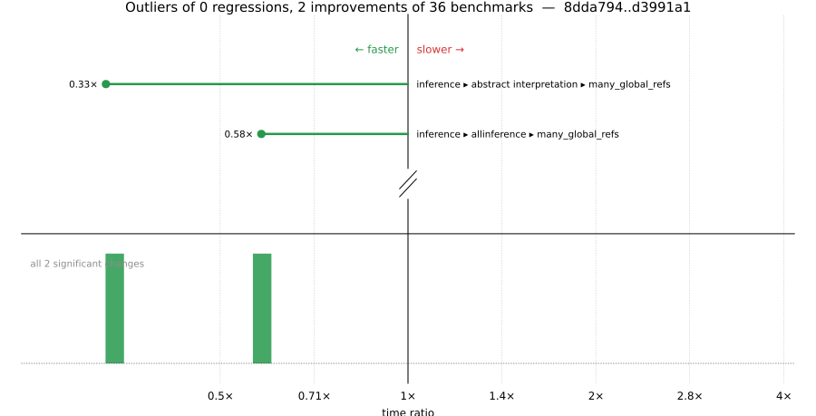

# Benchmark Report

## Summary

**36** benchmarks were executed, **0** showed regressions, and **2** showed improvements.



## Job Properties

*Commits:* [JuliaLang/julia@d3991a1b78579c778e21b77b43c35c03d538e503](https://github.com/JuliaLang/julia/commit/d3991a1b78579c778e21b77b43c35c03d538e503) vs [JuliaLang/julia@8dda794eec3571f4776fac724629459301e3ecfd](https://github.com/JuliaLang/julia/commit/8dda794eec3571f4776fac724629459301e3ecfd)

*Comparison Diff:* [8dda794...d3991a1](https://github.com/JuliaLang/julia/compare/8dda794eec3571f4776fac724629459301e3ecfd...d3991a1b78579c778e21b77b43c35c03d538e503)

*Triggered By:* [link](https://github.com/JuliaLang/julia/pull/65126#issuecomment-7048024965)

*Tag Predicate:* `"inference"`

## Results

*Note: If Chrome is your browser, I strongly recommend installing the [Wide GitHub](https://chrome.google.com/webstore/detail/wide-github/kaalofacklcidaampbokdplbklpeldpj?hl=en)
extension, which makes the result table easier to read.*

Below is a table of this job's results, obtained by running the benchmarks found in
[JuliaCI/BaseBenchmarks.jl](https://github.com/JuliaCI/BaseBenchmarks.jl). The values
listed in the `ID` column have the structure `[parent_group, child_group, ..., key]`,
and can be used to index into the BaseBenchmarks suite to retrieve the corresponding
benchmarks.

The percentages accompanying time and memory values in the below table are noise tolerances. The "true"
time/memory value for a given benchmark is expected to fall within this percentage of the reported value.

A ratio greater than `1.0` denotes a possible regression (marked with :x:), while a ratio less
than `1.0` denotes a possible improvement (marked with :white_check_mark:). Only significant results - results
that indicate possible regressions or improvements - are shown below (thus, an empty table means that all
benchmark results remained invariant between builds).

| ID | time ratio | memory ratio |
|----|------------|--------------|
| `["inference", "abstract interpretation", "many_global_refs"]` | 0.33 (5%) :white_check_mark: | 0.66 (1%) :white_check_mark: |
| `["inference", "allinference", "many_global_refs"]` | 0.58 (5%) :white_check_mark: | 0.86 (1%) :white_check_mark: |

## Benchmark Group List

Here's a list of all the benchmark groups executed by this job:

- `["inference", "abstract interpretation"]`
- `["inference", "allinference"]`
- `["inference", "optimization"]`

## Version Info

#### Primary Build

```
Julia Version 1.15.0-DEV.879
Build Info:
  Commit d3991a1b78 (2026-11-20 18:56 UTC)
  GC: Built with stock GC
  Base Sysimage: native (x86_64-linux-gnu)
  Matched Sysimage: native
Platform Info:
  OS: Linux (x86_64-unknown-linux-gnu)
      Ubuntu 22.04.5 LTS
  uname: Linux 5.15.0-203-generic #213-Ubuntu SMP Fri Oct 23 13:21:06 UTC 2026 x86_64 x86_64
  CPU: Intel(R) Xeon(R) CPU E3-1241 v3 @ 3.50GHz (haswell):
              speed         user         nice          sys         idle          irq
       #1  3500 MHz       3491 s          1 s        334 s     249765 s          0 s  
       #2  3500 MHz      44417 s          0 s        769 s     208865 s          0 s  
       #3  3500 MHz       3517 s          0 s        182 s     250331 s          0 s  
       #4  3499 MHz       3176 s          0 s        173 s     250715 s          0 s  
       #5  3503 MHz       3475 s          0 s        166 s     250221 s          0 s  
       #6  3501 MHz       3363 s          2 s        164 s     249387 s          0 s  
       #7  3502 MHz       3517 s          0 s        177 s     250226 s          0 s  
       #8  3500 MHz       3273 s          1 s        168 s     250585 s          0 s  
  Memory: 31.301 GiB (23.264 GiB free)
  Uptime: 254263.05 sec
  Load Avg:  1.01  1.14  1.87
  WORD_SIZE: 64
  LLVM: libLLVM-23.1.4 (ORCJIT, haswell)
Threads: 1 default, 1 interactive, 1 GC (on 8 virtual cores)

```

#### Comparison Build

```
Julia Version 1.15.0-DEV.878
Build Info:
  Commit 8dda794eec (2026-11-20 18:55 UTC)
  GC: Built with stock GC
  Base Sysimage: native (x86_64-linux-gnu)
  Matched Sysimage: native
Platform Info:
  OS: Linux (x86_64-unknown-linux-gnu)
      Ubuntu 22.04.5 LTS
  uname: Linux 5.15.0-203-generic #213-Ubuntu SMP Fri Oct 23 13:21:06 UTC 2026 x86_64 x86_64
  CPU: Intel(R) Xeon(R) CPU E3-1241 v3 @ 3.50GHz (haswell):
              speed         user         nice          sys         idle          irq
       #1  3500 MHz       3512 s          1 s        341 s     251155 s          0 s  
       #2  3500 MHz      45794 s          0 s        770 s     208979 s          0 s  
       #3  3501 MHz       3526 s          0 s        183 s     251814 s          0 s  
       #4  3500 MHz       3185 s          0 s        174 s     252198 s          0 s  
       #5  3503 MHz       3483 s          0 s        167 s     251704 s          0 s  
       #6  3501 MHz       3374 s          2 s        165 s     250865 s          0 s  
       #7  3500 MHz       3550 s          0 s        178 s     251684 s          0 s  
       #8  3502 MHz       3281 s          1 s        169 s     252068 s          0 s  
  Memory: 31.301 GiB (23.408 GiB free)
  Uptime: 255756.24 sec
  Load Avg:  1.03  1.03  1.2
  WORD_SIZE: 64
  LLVM: libLLVM-23.1.4 (ORCJIT, haswell)
Threads: 1 default, 1 interactive, 1 GC (on 8 virtual cores)

```

#### Nanosoldier
Nanosoldier commit: [`a31ca97`](https://github.com/JuliaCI/Nanosoldier.jl/commit/a31ca97d24f0e880a5d3b4ba999344a5fffb696f)
