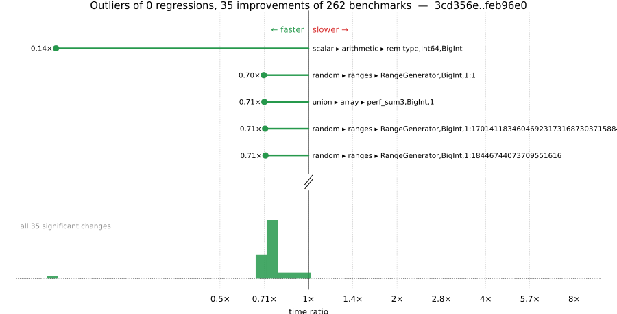

# Benchmark Report

## Summary

**262** benchmarks were executed, **0** showed regressions, and **35** showed improvements.



## Job Properties

*Commits:* [JuliaLang/julia@feb96e0a49a1dda0d7ca81fef38f6b384b78c885](https://github.com/JuliaLang/julia/commit/feb96e0a49a1dda0d7ca81fef38f6b384b78c885) vs [JuliaLang/julia@3cd356ecccb3a2b8d3d7cb397c46d798e5cc61b2](https://github.com/JuliaLang/julia/commit/3cd356ecccb3a2b8d3d7cb397c46d798e5cc61b2)

*Comparison Diff:* [3cd356e...feb96e0](https://github.com/JuliaLang/julia/compare/3cd356ecccb3a2b8d3d7cb397c46d798e5cc61b2...feb96e0a49a1dda0d7ca81fef38f6b384b78c885)

*Note:* Comparison is against the merge-base of `master` (the common ancestor of the PR branch and `master`), so it reflects only the PR's changes.

*Triggered By:* [link](https://github.com/JuliaLang/julia/pull/64089#issuecomment-6587227682)

*Tag Predicate:* `"Complex{BigInt}" || "BigInt"`

## Results

*Note: If Chrome is your browser, I strongly recommend installing the [Wide GitHub](https://chrome.google.com/webstore/detail/wide-github/kaalofacklcidaampbokdplbklpeldpj?hl=en)
extension, which makes the result table easier to read.*

Below is a table of this job's results, obtained by running the benchmarks found in
[JuliaCI/BaseBenchmarks.jl](https://github.com/JuliaCI/BaseBenchmarks.jl). The values
listed in the `ID` column have the structure `[parent_group, child_group, ..., key]`,
and can be used to index into the BaseBenchmarks suite to retrieve the corresponding
benchmarks.

The percentages accompanying time and memory values in the below table are noise tolerances. The "true"
time/memory value for a given benchmark is expected to fall within this percentage of the reported value.

A ratio greater than `1.0` denotes a possible regression (marked with :x:), while a ratio less
than `1.0` denotes a possible improvement (marked with :white_check_mark:). Only significant results - results
that indicate possible regressions or improvements - are shown below (thus, an empty table means that all
benchmark results remained invariant between builds).

| ID | time ratio | memory ratio |
|----|------------|--------------|
| `["random", "ranges", ("RangeGenerator", "BigInt", "1:1")]` | 0.70 (25%) :white_check_mark: | 1.00 (1%)  |
| `["random", "ranges", ("RangeGenerator", "BigInt", "1:170141183460469231731687303715884105728")]` | 0.71 (25%) :white_check_mark: | 1.00 (1%)  |
| `["random", "ranges", ("RangeGenerator", "BigInt", "1:18446744073709551615")]` | 0.72 (25%) :white_check_mark: | 1.00 (1%)  |
| `["random", "ranges", ("RangeGenerator", "BigInt", "1:18446744073709551616")]` | 0.71 (25%) :white_check_mark: | 1.00 (1%)  |
| `["random", "ranges", ("RangeGenerator", "BigInt", "1:4294967295")]` | 0.72 (25%) :white_check_mark: | 1.00 (1%)  |
| `["random", "ranges", ("RangeGenerator", "BigInt", "1:4294967297")]` | 0.72 (25%) :white_check_mark: | 1.00 (1%)  |
| `["random", "ranges", ("rand", "MersenneTwister", "BigInt", "RangeGenerator(1:1)")]` | 0.73 (25%) :white_check_mark: | 1.00 (1%)  |
| `["scalar", "arithmetic", ("rem type", "Int64", "BigInt")]` | 0.14 (40%) :white_check_mark: | 1.00 (1%)  |
| `["union", "array", ("broadcast", "*", "BigInt", "(false, false)")]` | 0.76 (5%) :white_check_mark: | 1.00 (1%)  |
| `["union", "array", ("broadcast", "*", "BigInt", "(false, true)")]` | 0.75 (5%) :white_check_mark: | 1.00 (1%)  |
| `["union", "array", ("broadcast", "*", "BigInt", "(true, true)")]` | 0.74 (5%) :white_check_mark: | 1.00 (1%)  |
| `["union", "array", ("broadcast", "abs", "BigInt", 0)]` | 0.75 (5%) :white_check_mark: | 1.00 (1%)  |
| `["union", "array", ("broadcast", "abs", "BigInt", 1)]` | 0.73 (5%) :white_check_mark: | 1.00 (1%)  |
| `["union", "array", ("broadcast", "identity", "BigInt", 0)]` | 0.92 (5%) :white_check_mark: | 1.00 (1%)  |
| `["union", "array", ("collect", "all", "BigInt", 0)]` | 0.95 (5%) :white_check_mark: | 1.00 (1%)  |
| `["union", "array", ("map", "*", "BigInt", "(false, false)")]` | 0.76 (5%) :white_check_mark: | 1.00 (1%)  |
| `["union", "array", ("map", "*", "BigInt", "(false, true)")]` | 0.76 (5%) :white_check_mark: | 1.00 (1%)  |
| `["union", "array", ("map", "*", "BigInt", "(true, true)")]` | 0.74 (5%) :white_check_mark: | 1.00 (1%)  |
| `["union", "array", ("map", "abs", "BigInt", 0)]` | 0.74 (5%) :white_check_mark: | 1.00 (1%)  |
| `["union", "array", ("map", "abs", "BigInt", 1)]` | 0.72 (5%) :white_check_mark: | 1.00 (1%)  |
| `["union", "array", ("map", "identity", "BigInt", 0)]` | 0.94 (5%) :white_check_mark: | 1.00 (1%)  |
| `["union", "array", ("perf_binaryop", "*", "BigInt", "(false, false)")]` | 0.76 (5%) :white_check_mark: | 1.00 (1%)  |
| `["union", "array", ("perf_binaryop", "*", "BigInt", "(false, true)")]` | 0.75 (5%) :white_check_mark: | 1.00 (1%)  |
| `["union", "array", ("perf_binaryop", "*", "BigInt", "(true, true)")]` | 0.73 (5%) :white_check_mark: | 1.00 (1%)  |
| `["union", "array", ("perf_simplecopy", "BigInt", 0)]` | 0.90 (5%) :white_check_mark: | 1.00 (1%)  |
| `["union", "array", ("perf_sum", "BigInt", 0)]` | 0.74 (5%) :white_check_mark: | 1.00 (1%)  |
| `["union", "array", ("perf_sum", "BigInt", 1)]` | 0.72 (5%) :white_check_mark: | 1.00 (1%)  |
| `["union", "array", ("perf_sum2", "BigInt", 0)]` | 0.74 (5%) :white_check_mark: | 1.00 (1%)  |
| `["union", "array", ("perf_sum2", "BigInt", 1)]` | 0.72 (5%) :white_check_mark: | 1.00 (1%)  |
| `["union", "array", ("perf_sum3", "BigInt", 0)]` | 0.74 (5%) :white_check_mark: | 1.00 (1%)  |
| `["union", "array", ("perf_sum3", "BigInt", 1)]` | 0.71 (5%) :white_check_mark: | 1.00 (1%)  |
| `["union", "array", ("perf_sum4", "BigInt", 0)]` | 0.83 (5%) :white_check_mark: | 1.00 (1%)  |
| `["union", "array", ("perf_sum4", "BigInt", 1)]` | 0.79 (5%) :white_check_mark: | 1.00 (1%)  |
| `["union", "array", ("skipmissing", "perf_sumskipmissing", "BigInt", 0)]` | 0.74 (5%) :white_check_mark: | 1.00 (1%)  |
| `["union", "array", ("skipmissing", "sum", "BigInt", 0)]` | 0.75 (5%) :white_check_mark: | 1.00 (1%)  |

## Benchmark Group List

Here's a list of all the benchmark groups executed by this job:

- `["random", "ranges"]`
- `["scalar", "arithmetic"]`
- `["scalar", "fastmath"]`
- `["scalar", "intfuncs"]`
- `["scalar", "predicate"]`
- `["union", "array"]`

## Version Info

#### Primary Build

```
Julia Version 1.15.0-DEV.105
Build Info:
  Commit feb96e0a49 (2026-11-02 18:09 UTC)
  GC: Built with stock GC
  Base Sysimage: native (x86_64-linux-gnu)
  Matched Sysimage: native
Platform Info:
  OS: Linux (x86_64-unknown-linux-gnu)
      Ubuntu 22.04.5 LTS
  uname: Linux 5.15.0-174-generic #184-Ubuntu SMP Fri Mar 13 18:41:50 UTC 2026 x86_64 x86_64
  CPU: Intel(R) Xeon(R) CPU E3-1241 v3 @ 3.50GHz (haswell):
              speed         user         nice          sys         idle          irq
       #1  3500 MHz     170220 s        110 s      52432 s   18212136 s          0 s  
       #2  3501 MHz    1798651 s         75 s      69694 s   16583774 s          0 s  
       #3  3500 MHz     142464 s         72 s      29026 s   18223922 s          0 s  
       #4  3500 MHz     149002 s         49 s      32283 s   18271713 s          0 s  
  Memory: 31.301 GiB (21.812 GiB free)
  Uptime: 1.847836351e7 sec
  Load Avg:  1.02  1.58  2.49
  WORD_SIZE: 64
  LLVM: libLLVM-23.1.4 (ORCJIT, haswell)
Threads: 1 default, 1 interactive, 1 GC (on 4 virtual cores)

```

#### Comparison Build

```
Julia Version 1.15.0-DEV.104
Build Info:
  Commit 3cd356eccc (2026-10-23 16:54 UTC)
  GC: Built with stock GC
  Base Sysimage: native (x86_64-linux-gnu)
  Matched Sysimage: native
Platform Info:
  OS: Linux (x86_64-unknown-linux-gnu)
      Ubuntu 22.04.5 LTS
  uname: Linux 5.15.0-174-generic #184-Ubuntu SMP Fri Mar 13 18:41:50 UTC 2026 x86_64 x86_64
  CPU: Intel(R) Xeon(R) CPU E3-1241 v3 @ 3.50GHz (haswell):
              speed         user         nice          sys         idle          irq
       #1  3500 MHz     170240 s        110 s      52437 s   18212819 s          0 s  
       #2  3500 MHz    1799279 s         75 s      69706 s   16583846 s          0 s  
       #3  3500 MHz     142498 s         72 s      29033 s   18224591 s          0 s  
       #4  3500 MHz     149044 s         49 s      32284 s   18272382 s          0 s  
  Memory: 31.301 GiB (21.808 GiB free)
  Uptime: 1.84790753e7 sec
  Load Avg:  1.0  1.06  1.69
  WORD_SIZE: 64
  LLVM: libLLVM-23.1.4 (ORCJIT, haswell)
Threads: 1 default, 1 interactive, 1 GC (on 4 virtual cores)

```

#### Nanosoldier
Nanosoldier commit: [`337e360`](https://github.com/JuliaCI/Nanosoldier.jl/commit/337e360a4a5ca6d9e9b96245ce90e4f3a3be95c6)
